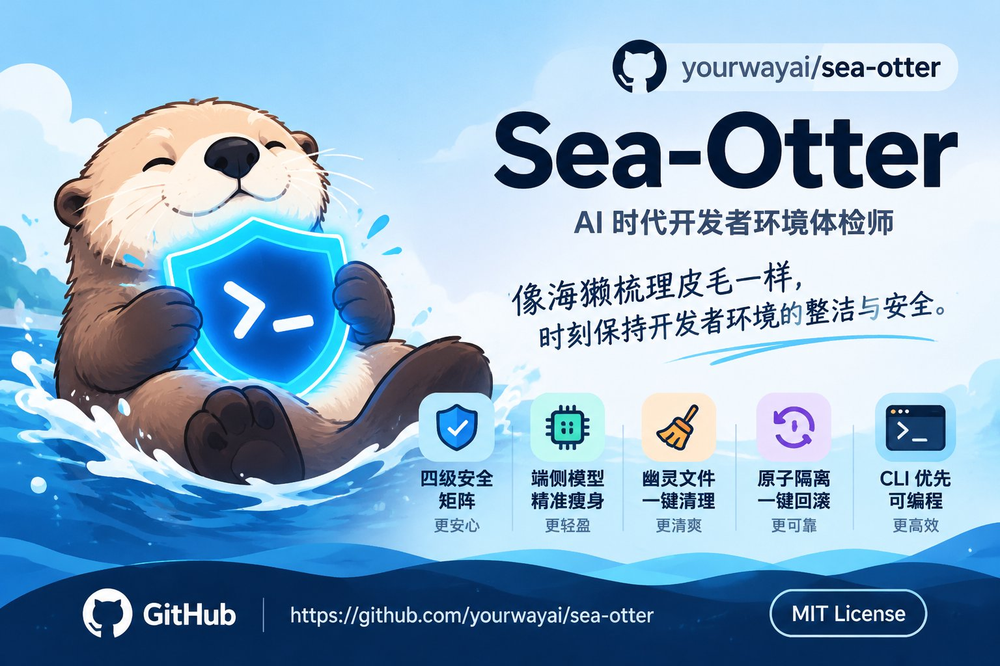

<p align="center">
  
</p>

<h1 align="center">Sea-Otter 🦦</h1>

<p align="center">
  <strong>DevSweep Engine · 面向新一代 AI 编程工具与开发者 CLI/Agent 的精细化清理与体检工具</strong><br>
  <em>像海獭（Sea Otter）梳理皮毛一样，时刻保持开发者环境的整洁与安全。</em>
</p>

<p align="center">
  <a href="https://github.com/yourwayai/sea-otter/releases"></a>
  <a href="https://github.com/yourwayai/sea-otter"></a>
  <a href="LICENSE"></a>
  <a href="README_EN.md"></a>
</p>

<p align="center">
  
</p>

---

## 🌟 为什么需要 Sea-Otter？

传统清理工具（如 CleanMyMac、AppCleaner）通常采用“以 App Bundle 为中心”的粗放匹配模式，主要扫描 `~/Library` 下的 Bundle ID 文件夹。这在面对现代 AI 编程助手、端侧大模型与 Agent CLI（如 Claude Code, Codex, Cherry Studio, Alma, WorkBuddy, Antigravity, Kiro 等）时往往失效：

- **遗漏核心 Dotfiles**：大量配置与会话库分散在 `~/.claude`, `~/.codex`, `~/.gemini`, `~/.ollama` 等家目录隐藏文件夹中。
- **端侧大模型与向量库透明**：Chrome 会静默拉取 **4.0 GB Gemini Nano** (`OptGuideOnDeviceModel`)，AI 客户端堆积数 GB 会话附件与 `IndexedDB` 向量库，传统工具对其完全失明。
- **根目录散落与测试通道孤岛**：跨平台代码 Bug 会在 `~/Library/Application Support/` 根节点生成 `(null)`、`default.store`、`.ACCC_Lock` 或空骨架目录；长期停用的 Canary/Dev/Beta 测试通道滞留大量无用缓存。
- **孤儿残留与敏感凭证混杂**：软件卸载后残留的 SQLite 会话库、OAuth Token、Refresh Token 与代码缓存混杂，缺乏敏感度分级与可恢复机制。
- **误伤开发者资产**：AI Agent 常直接创建工程目录，缺乏对 `.git` / `.obsidian` 工作区的强制免疫防线。

---

## ✨ 核心能力 (v1.2 Architecture)

- 🧠 **端侧大模型专项引擎 (`AIModelScanner`)**：支持 `.gguf`、`.safetensors`、`.onnx`、`.bin`、`.pt`、`.pth`、`GGUF` Magic Header 与 Chrome Optimization Guide (`Gemini Nano`) 识别，支持 `scan/clean --models` 独立修剪而不破坏宿主配置。
- ✂️ **细粒度会话与向量裁剪 (`--slim`)**：支持 `sub_targets` 递归拆解与 `prunable` 标识，精准清理会话大附件（`Data/Files`）与向量嵌入库（`IndexedDB`），100% 免疫核心数据库（如 `cherrystudio.sqlite`）与助手配置。
- 👻 **根目录散落与幽灵探测 (`RootOrphanScanner`, `--ghosts`)**：直击存储根节点，自动捕获 `^(\(null\)|undefined|null|none|\s+)$` 异常目录、历史解包单图（`2052-TM*`）、CoreData 违规库（`default.store*`）、死锁标记（`.ACCC_Lock`/`.ADCS_Lock`）与 `< 64KB` 骨架空目录。
- 🏝️ **多通道发布孤岛交叉检测 (`ChannelRedundancyScanner`, `--channels`)**：自动关联 Chrome / Edge / VS Code 家族矩阵，当正式版近期高频活跃而测试通道（Canary / Dev / Beta / Insiders）超过 **90 天**未启动时，提示一键安全清理。
- 🔗 **三级反向映射孤儿探测 (`AssociationEngine`, `--associations`)**：通过 `Info.plist` / `CFBundleIdentifier` 反查、高频脱节特征字典（如 `Code` → VS Code、`com.openai.chat` → ChatGPT）及 **180 天**无进程访问启发式推导，精准捕获已卸载历史应用残留。
- ⏪ **原子隔离区与一键无损回滚 (`sea-otter rollback`)**：清理时自动在 `~/.Trash/AppSupport_Cleanup_<timestamp>/` 建立隔离目录并生成标准 `manifest.json`（v1.2.0），支持重名消歧、冲突保护与按会话一键无损恢复。

---

## 🛡️ 核心防线：四级安全防护矩阵 (Four-Tier Safety Risk Matrix)

面向现代开发者与 AI 软件的磁盘治理，**安全性高于一切**。Sea-Otter 弃用传统的二元判定，正式落地四级安全防护矩阵：

| 级别 | 定义 | 典型对象 | 处理与勾选策略 |
| :--- | :--- | :--- | :--- |
| **🟢 L1: 极低风险 (Zero-Impact Junk)** | 纯垃圾文件、空锁、跨平台 Bug 目录、纯缓存 | `(null)` 幽灵目录、`default.store`、`.ACCC_Lock`、骨架空目录、Chrome/Edge 纯缓存 | **默认勾选**，一键归档隔离 |
| **🟡 L2: 明确已卸载 (Orphaned Apps)** | 对应软件已删除，残留孤儿历史配置/旧测试通道 | 已卸载的 `Codex`、`Cursor`、`Chrome Beta` 测试通道孤岛等 | **默认勾选**，移入原子隔离区 |
| **🟠 L3: 在用软件减负 (Bloatware/Cache)** | 正在使用的软件，但内部堆积了模型/大附件/缓存 | Chrome 端侧模型 (4GB)、Cherry Studio 附件/向量库、在用软件缓存 | **默认不勾选**，需 `--include-l3` 或 `--models`/`--slim`/`--channels` 确认 |
| **🔴 L4: 绝对安全红线 (Protected System)** | macOS 系统核心数据、权限库、代码工程、活跃进程 | `com.apple.TCC`、`AddressBook`、`CloudDocs`、`.git` 仓库、运行中的进程 | **硬编码屏蔽阻断**，完全禁止删除 |

### 四大绝对安全铁律

1. **系统红线库 (System Redline Vault) 强阻断**：
   - 对 `com.apple.TCC`、`AddressBook`、`CallHistoryDB`、`CloudDocs`、`Keychain`、`com.apple.sharedfilelist`、`Safari`、`Mail`、`Photos` 等系统关键库，以及 macOS 原生系统目录设立绝对硬白名单，禁止任何触碰。
2. **多维存活状态交叉验证 (Process & Lock Guard)**：
   - 判定软件是否在用绝不仅看 `/Applications/*.app`，而是交叉比对系统进程表（`pgrep`）、常驻守护进程与单例文件锁（`SingletonLock`）。活跃工具自动上锁标记为 **`🔵 正在运行 (保护锁定)`**。
3. **代码仓库与工程资产“强制免疫”**：
   - 任何待清理路径自动探测 `.git`、`.svn`、`.hg`、`.obsidian` 标识及规则中的 `exclude_paths`（含通配符内部文件校验）。只要检测到工程资产，**强制阻断清理**。
4. **原子隔离归档与敏感凭据审计**：
   - 清理默认归档至 `~/.Trash/AppSupport_Cleanup_<timestamp>/` 并附带 `manifest.json`，随时执行 `sea-otter rollback` 无损还原；明文 OAuth Token 和私钥自动打上 🔑 告警标并默认跳过。

---

## 🗂 项目结构

```text
sea-otter/
├── assets/                      # 项目资源（Logo、宣传 Banner 等）
│   ├── banner.jpg
│   └── logo.png
├── schema/
│   └── rule.schema.json         # 规则库 JSON Schema 规范 (v1.2)
├── rules/                       # 19 款主流 AI 工具与开发者生态指纹规则 (YAML)
│   ├── 5ire.yaml                # 5ire AI Desktop (BGE-M3 本地向量模型)
│   ├── alma.yaml                # Alma AI Agent
│   ├── bolt.yaml                # Bolt (bolt.new / Bolt.diy)
│   ├── cherry-studio.yaml       # Cherry Studio (会话大附件与向量库细粒度拆分)
│   ├── claude-code.yaml         # Anthropic Claude Code CLI
│   ├── codex.yaml               # OpenAI Codex CLI
│   ├── cursor.yaml              # Cursor (AI IDE)
│   ├── gemini-antigravity.yaml  # Google Antigravity & Gemini CLI
│   ├── google-chrome.yaml       # Google Chrome (Gemini Nano 端侧模型、多通道与幽灵规则)
│   ├── hermes.yaml              # Hermes Agent (多进程守护网关)
│   ├── kiro.yaml                # Kiro IDE
│   ├── lark-and-steam.yaml      # 飞书 (Lark/Feishu) & Steam 孤儿库 (保护游戏本体与存档)
│   ├── microsoft-edge.yaml      # Microsoft Edge (多通道矩阵、端侧语音/语言模型)
│   ├── ollama.yaml              # Ollama 本地模型运行时
│   ├── trae.yaml                # ByteDance Trae AI IDE
│   ├── vscode.yaml              # Visual Studio Code (多通道矩阵与工作区缓存)
│   ├── wechat-devtools.yaml     # 微信开发者工具 (模拟器与小程序编译缓存)
│   ├── windsurf.yaml            # Codeium Windsurf Editor
│   └── workbuddy.yaml           # WorkBuddy AI
├── docs/
│   ├── architecture-and-lessons-learned.md # 实战经验与架构指南 (v1.2 Milestone)
│   ├── rule-schema.md           # 规则规范说明文档
│   └── todo-roadmap.md          # 演进路线图与迭代看板
├── sea_otter/                   # 核心 Python 引擎 (含内置 rules/ 与 schema/ 同步副本)
│   ├── safety.py                # 四级安全防护矩阵与系统红线库
│   ├── scanner.py               # RuleScanner / AIModelScanner / RootOrphanScanner / ChannelRedundancyScanner / AssociationEngine
│   ├── cleaner.py               # SafeCleaner 与 QuarantineManager (原子隔离与无损回滚)
│   ├── validator.py             # Rule Schema v1.2 零依赖深度校验器
│   ├── ui.py                    # 终端视觉与多维状态/风险/模型/幽灵/通道徽标
│   └── cli.py                   # 命令行交互与子命令调度
├── tests/
│   └── test_suite.py            # 自动化单元测试套件 (56 项全覆盖)
├── pyproject.toml
├── setup.py
├── .gitignore
├── README.md
└── README_EN.md
```

---

## 📦 安装与配置 (Installation)

### 方式 1: 直接从 GitHub 一键安装 (推荐)

无需下载源码，直接使用 `pip` 或 `pipx` 即可安装到系统中：

```bash
# 使用 pip 安装到当前用户空间
pip install --user git+https://github.com/yourwayai/sea-otter.git

# 或者使用 pipx 进行独立环境隔离安装
pipx install git+https://github.com/yourwayai/sea-otter.git
```

> **提示**：安装完成后，请确保 `~/.local/bin` 或 `~/Library/Python/3.x/bin` 已在您的系统 `PATH` 中。

---

### 方式 2: 源码克隆与本地安装 (开发者模式)

如果您希望本地调试或为 Sea-Otter 贡献规则：

```bash
# 1. 克隆代码仓库
git clone https://github.com/yourwayai/sea-otter.git
cd sea-otter

# 2. 安装可编辑开发版本
pip install --user -e .

# 3. 挂载到本地 PATH (可选，便于在任意目录执行)
ln -sf $(python3 -m site --user-base)/bin/sea-otter ~/.local/bin/sea-otter
```

---

### 方式 3: 免安装直接运行 (Zero Install)

克隆项目后直接执行根目录的脚本即可：

```bash
git clone https://github.com/yourwayai/sea-otter.git
cd sea-otter
./sea-otter scan
```

---

## 💻 CLI 使用指南

直接输入 `sea-otter` 可启动交互式控制台主菜单；也支持完整子命令用于快速排查与脚本自动化：

### 1. 扫描与体检 (`scan`)
```bash
# 默认全盘扫描（包含 19 款规则、根目录幽灵残留与多通道孤岛）
sea-otter scan

# 仅扫描指定的一个或多个工具
sea-otter scan cursor codex google-chrome

# 专项扫描本地 AI 端侧大模型与权重占用 (如 Gemini Nano, GGUF, BGE-M3)
sea-otter scan --models

# 专项扫描支持安全减负的目标 (会话大附件、向量嵌入库、缓存)
sea-otter scan --slim

# 专项扫描根目录散落文件、幽灵目录与骨架空目录 (L1 极低风险)
sea-otter scan --ghosts

# 专项检测停用超过 90 天的浏览器/IDE 多通道测试孤岛 (Canary/Dev/Beta)
sea-otter scan --channels

# 专项执行三级反向映射孤儿扫描 (Plist / 特征库 / 180天启发式推导)
sea-otter scan --associations

# 显示所有工具（包含未安装且整洁无残留的项）
sea-otter scan --all

# 以 JSON 格式输出（含 risk_level、ghost_type、channel_name 等完整元数据）
sea-otter scan --json
```

### 2. 安全清理 (`clean`)
默认仅清理通过安全仲裁的 **L1（极低风险）** 与 **L2（明确已卸载）** 孤儿残留，并写入 `~/.Trash/AppSupport_Cleanup_<timestamp>/` 原子隔离区：

```bash
# Dry-run 模拟预览（只读模式，不修改任何文件系统）
sea-otter clean --dry-run
sea-otter clean cursor --dry-run

# 专项清理本地 AI 端侧大模型（自动放行 L3 模型权重，保留软件配置）
sea-otter clean --models --dry-run

# 安全减负模式（仅释放会话大附件、向量嵌入库与缓存，100% 保护核心数据库与密钥）
sea-otter clean cherry-studio --slim --dry-run

# 一键清理根目录散落文件、幽灵目录与骨架空目录
sea-otter clean --ghosts --dry-run

# 一键清理停用超过 90 天的测试通道孤岛 (Canary/Dev/Beta)
sea-otter clean --channels --dry-run

# 专项清理三级反向映射引擎推导的已卸载应用孤儿目录
sea-otter clean --associations --dry-run

# 仅清理纯缓存（Cache）分类
sea-otter clean --category caches --dry-run

# 纳入全部 L3 在用软件减负项或敏感凭据
sea-otter clean --include-l3 --dry-run
sea-otter clean --include-secrets --dry-run

# 免交互确认直接归档至原子隔离区
sea-otter clean cursor -y
```

### 3. 原子隔离区查看与无损回滚 (`rollback`)
```bash
# 列出 ~/.Trash 中所有历史清理会话及 manifest.json 摘要
sea-otter rollback --list

# 预览恢复最近一次清理会话（只读 Dry-run）
sea-otter rollback --dry-run

# 一键无损恢复最近一次（或指定 session_id）清理的所有文件至原路径
sea-otter rollback
sea-otter rollback cleanup_20261125_114500 -y

# 若原路径已新建同名文件，显式指定 --force 覆盖恢复
sea-otter rollback cleanup_20261125_114500 --force -y
```

### 4. 规则库查看与深度校验 (`rules`) & 项目信息 (`about`)
```bash
# 查看内置收录的 19 款工具规则列表
sea-otter rules list

# 使用 Rule Schema v1.2 校验所有规则的字段、通道矩阵与幽灵正则语法
sea-otter rules validate

# 查看 Sea-Otter 设计理念与安全防线
sea-otter about
```

---

## 🚀 规划路线 (Roadmap)

- [x] **Phase 1 & P0: 核心安全矩阵与 AI 资产治理**
  - [x] **四级安全防护矩阵 (L1 ~ L4)**、系统红线库 (`com.apple.TCC` 等)、进程锁验证与 `.git` 免疫
  - [x] **端侧大模型识别引擎 (`AIModelScanner`)**（支持 Gemini Nano 4GB 模型独立裁剪）
  - [x] **本地会话库与向量嵌入细粒度裁剪 (`--slim`)**（支持 `sub_targets` 拆解与核心库硬隔离）
  - [x] **Rule Schema v1.2 升级与深度校验器 (`validator.py`)**
- [x] **Phase 2 & P1: 扫描盲区穿透与原子无损回滚**
  - [x] **跨平台 Bug 与根目录散落探测 (`RootOrphanScanner`)**：`(null)` 幽灵目录、散落单文件、死锁标记、`< 64KB` 骨架空目录
  - [x] **多通道发布孤岛检测 (`ChannelRedundancyScanner`)**：Edge / Chrome / VS Code 90 天活跃度交叉仲裁
  - [x] **原子隔离归档与一键无损回滚系统 (`sea-otter rollback`)**：`manifest.json` 完整元数据清单
  - [x] **官方规则库第一轮扩充**：新增并完善 Chrome / Edge / 微信开发者工具 / 飞书 & Steam / VS Code（共 19 款规则）
- [ ] **Phase 3 & P2: 生态扩展、反向推导与 Agentic 交付**
  - [x] 应用名与存储路径脱节的三级反向映射引擎 (`Association Engine`)
  - [ ] 敏感凭据与 API Key 深度隐私审计 (`Secret Leak Warning`)
  - [ ] Antigravity / Claude Code 原生 MCP Server (`sea-otter-mcp`) 集成
  - [ ] `os.scandir` + `ThreadPoolExecutor` 并发 I/O 性能优化

---

## 📄 开源协议

本项目基于 [MIT License](LICENSE) 开源。欢迎通过 PR 贡献更多工具规则，提交前请执行 `sea-otter rules validate` 与 `python3 -m unittest tests.test_suite` 验证合规性。
