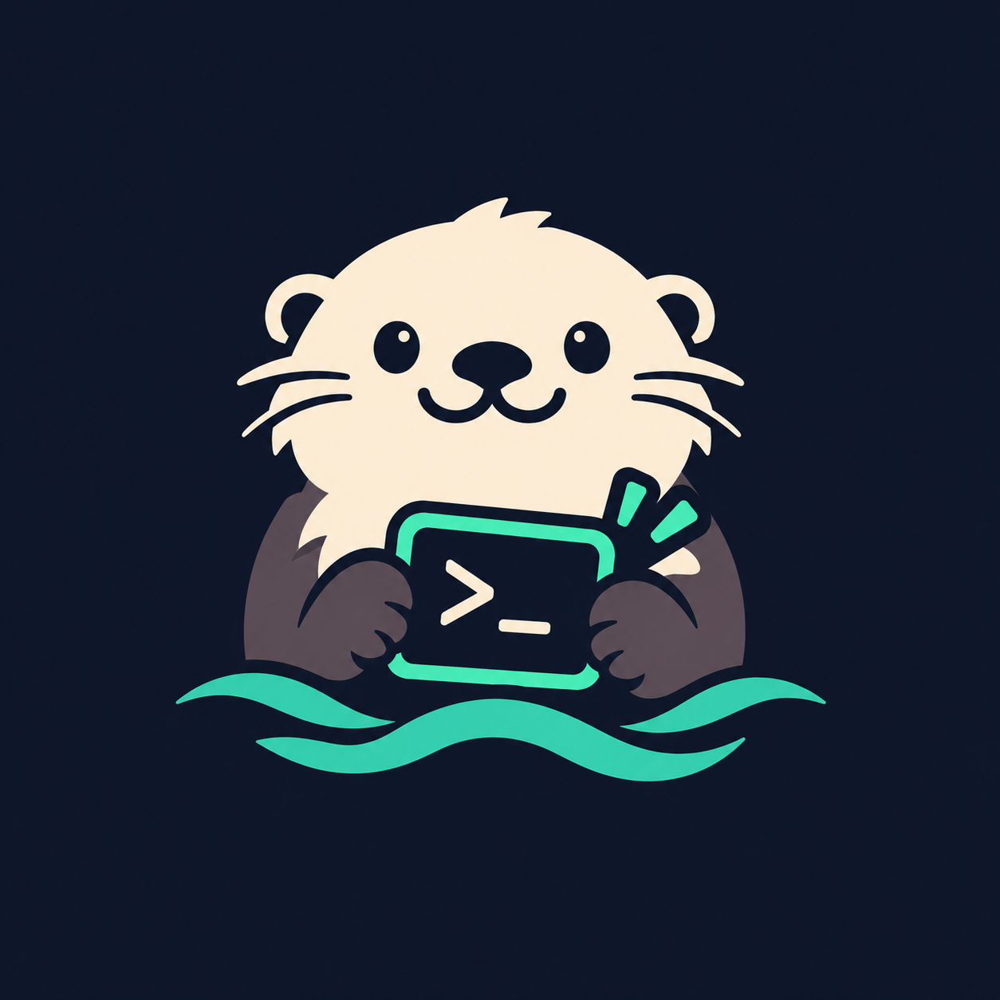

<p align="center">
  
</p>

<h1 align="center">Sea-Otter 🦦</h1>

<p align="center">
  <strong>DevSweep Engine · 面向新一代 AI 编程工具与开发者 CLI/Agent 的精细化清理与体检工具</strong><br>
  <em>像海獭（Sea Otter）梳理皮毛一样，时刻保持开发者环境的整洁与安全。</em>
</p>

<p align="center">
  <a href="https://github.com/yourwayai/sea-otter/releases"></a>
  <a href="LICENSE"></a>
  <a href="README_EN.md"></a>
</p>

---

## 🌟 为什么需要 Sea-Otter？

传统清理工具（如 CleanMyMac、AppCleaner）通常采用“以 App Bundle 为中心”的粗放匹配模式，主要扫描 `~/Library` 下的 Bundle ID 文件夹。这在面对现代 AI 编程助手与 Agent CLI（如 Claude Code, Codex, Alma, WorkBuddy, Antigravity, Kiro 等）时往往失效：
- **遗漏核心 Dotfiles**：大量数据分散在 `~/.claude`, `~/.codex`, `~/.gemini`, `~/.workbuddy` 等家目录隐藏文件夹中。
- **孤儿残留识别盲区**：软件已被拖入废纸篓删除，但残留的会话历史、向量数据库、CLI 软链接和 OAuth Token 依然长期霸占空间。
- **敏感数据泄露风险**：Token / Refresh Token / OAuth 凭证与代码缓存混杂，缺乏敏感度分级。
- **误伤开发者资产**：AI Agent 经常直接在用户目录下创建工作区，缺乏对 `.git` 项目的安全防线。

---

## 🗂 项目结构

```text
sea-otter/
├── assets/                      # 项目资源（Logo 图标等）
│   └── logo.png
├── schema/
│   └── rule.schema.json         # 规则库 JSON Schema 规范 (v1.0)
├── rules/                       # 各大 AI/开发者工具精细化指纹规则 (YAML)
│   ├── alma.yaml                # Alma AI Agent
│   ├── bolt.yaml                # Bolt (bolt.new / Bolt.diy)
│   ├── cherry-studio.yaml       # Cherry Studio (多模型客户端)
│   ├── claude-code.yaml         # Anthropic Claude Code CLI
│   ├── codex.yaml               # OpenAI Codex CLI
│   ├── cursor.yaml              # Cursor (AI IDE)
│   ├── gemini-antigravity.yaml  # Google Antigravity & Gemini CLI
│   ├── kiro.yaml                # Kiro IDE
│   ├── ollama.yaml              # Ollama 本地模型运行时
│   ├── trae.yaml                # ByteDance Trae AI IDE
│   ├── windsurf.yaml            # Codeium Windsurf Editor
│   └── workbuddy.yaml           # WorkBuddy AI
├── docs/
│   └── rule-schema.md           # 架构设计规范与数据协议文档
├── .gitignore
└── README.md
```

---

## 📐 规则库规范与设计哲学

每条工具规则遵循四层架构：
1. **元信息（Metadata）**：工具唯一标识、名称、分类、厂商与主页。
2. **状态感知检测（Detection）**：检测 Bundle ID、App 路径与 CLI 命令，自动判定 `已安装 (Installed)` 还是 `孤儿残留 (Orphaned Residual)`。
3. **分级目标分类（Targets）**：
   - `caches`: 纯缓存（安全随时清理）
   - `preferences`: 偏好设置与窗口状态
   - `credentials`: 敏感凭据（OAuth Token、密钥，标记 `contains_secrets: true`）
   - `data_and_history`: 会话历史数据库与向量记忆
   - `configs`: 配置文件与插件 Skills（默认不勾选，防误删）
   - `binaries_and_scripts`: CLI 软链接与入口脚本
4. **安全防线（Safety Guard）**：强制 `.git` 仓库保护与核心用户主目录防伤拦截。

## 📦 安装与配置 (Installation)

### 方式 1: 直接从 GitHub 一键安装 (推荐)

无需下载源码，直接使用 `pip` 或 `pipx` 即可安装到系统中：

```bash
# 使用 pip 安装到当前用户空间
pip install --user git+https://github.com/yourwayai/sea-otter.git

# 或者使用 pipx 进行独立环境隔离安装
pipx install git+https://github.com/yourwayai/sea-otter.git
```

> **提示**：安装完成后，请确保 `~/.local/bin` 或 `~/Library/Python/3.x/bin` 已在您的系统 `PATH` 中。

---

### 方式 2: 源码克隆与本地安装 (开发者模式)

如果您希望本地调试或为 Sea-Otter 贡献规则：

```bash
# 1. 克隆代码仓库
git clone https://github.com/yourwayai/sea-otter.git
cd sea-otter

# 2. 安装并注册全局命令
pip install --user .

# 3. 挂载到本地 PATH (可选，便于在任意目录执行)
ln -sf $(python3 -m site --user-base)/bin/sea-otter ~/.local/bin/sea-otter
```

---

### 方式 3: 免安装直接运行 (Zero Install)

克隆项目后直接执行根目录的脚本即可：

```bash
git clone https://github.com/yourwayai/sea-otter.git
cd sea-otter
./sea-otter scan
```

---

## 💻 CLI 使用指南

无需复杂的配置，直接在终端执行即可：

### 1. 扫描与体检 (`scan`)
```bash
# 默认扫描所有规则，并输出占用空间与软件状态报告
./sea-otter scan

# 仅扫描指定的一个或多个工具
./sea-otter scan cursor codex claude-code

# 显示所有工具（包含未安装且整洁无残留的项）
./sea-otter scan --all

# 以 JSON 格式输出（供 Raycast 插件或第三方脚本调用）
./sea-otter scan --json
```

### 2. 安全清理 (`clean`)
默认所有被删除的目标都将**安全移入 macOS 废纸篓（Trash）**，用户随时可以“放回原处”，杜绝误删风险：

```bash
# Dry-run 模拟预览（只读，不修改任何文件系统）
./sea-otter clean --dry-run
./sea-otter clean cursor --dry-run

# 仅清理纯缓存（Cache）
./sea-otter clean --category caches --dry-run

# 包含敏感凭据一起清理（默认会保护跳过 Token/密钥）
./sea-otter clean cursor --include-secrets

# 免交互确认直接清理
./sea-otter clean cursor -y
```

### 3. 规则库查看与校验 (`rules`)
```bash
# 查看内置收录的工具规则列表
./sea-otter rules list

# 校验所有规则的 YAML 规范与字段完整性
./sea-otter rules validate
```

---

## 🚀 规划路线 (Roadmap)

- [x] **Phase 1: 规范定义与首批实测指纹库沉淀** (v1.0 Schema + 12 款主流核心工具)
- [x] **Phase 2: 本地扫描与空间统计引擎 (MVP Scanner & CLI)**
  - 支持双态检测 (`已安装` vs `孤儿残留`)
  - 递归精确计算占用容量（智能嵌套路径去重）
  - Dry-run 只读预览与终端彩色展示
  - `.git` 仓库保护与用户关键根目录拦截防线
  - 移入 macOS 系统废纸篓安全删除机制
- [ ] **Phase 3: 规则社区生态与多端交付**
  - Raycast 插件扩展（基于 `--json` 输出快速构建）
  - Homebrew 自动化打包与发布
  - 规则在线动态同步更新 (`sea-otter update`)
