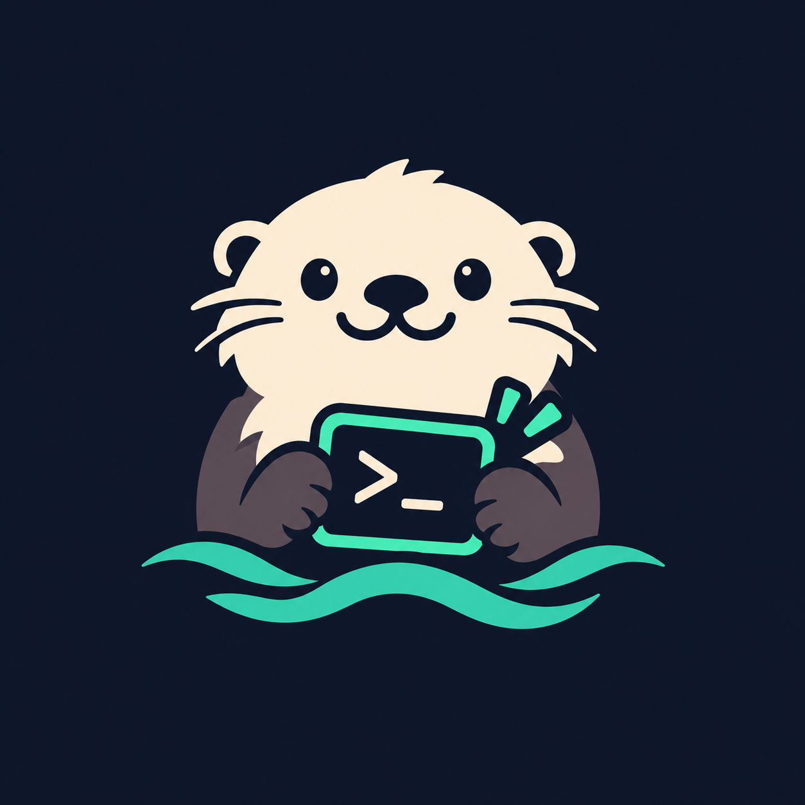

<p align="center">
  
</p>

<h1 align="center">Sea-Otter 🦦</h1>

<p align="center">
  <strong>DevSweep Engine · Precision Health Inspection & Cleanup Tool for Next-Gen AI Coding Assistants & Agent CLIs</strong><br>
  <em>Clean your AI developer tools just like an otter grooms its fur!</em>
</p>

<p align="center">
  <a href="https://github.com/yourwayai/sea-otter/releases"></a>
  <a href="LICENSE"></a>
  <a href="https://github.com/yourwayai/sea-otter"></a>
  <a href="README.md"></a>
</p>

---

## 🌟 Why Sea-Otter?

Traditional Mac cleanup apps (such as CleanMyMac, AppCleaner) typically adopt an "App Bundle-centric" approach, mostly checking Bundle ID folders under `~/Library`. This approach completely falls short when dealing with modern AI coding assistants and autonomous Agent CLIs (e.g., Claude Code, Codex, Cursor, Windsurf, Trae, Ollama, Hermes, 5ire):

- **Hidden Dotfile Blindspots**: Megabytes or gigabytes of databases, embeddings, and configs are scattered across hidden home directories like `~/.claude`, `~/.codex`, `~/.gemini`, `~/.workbuddy-ai`.
- **Orphan Residual Accumulation**: Even after dragging `.app` to Trash, heavy background daemons, GBs of vector models, and SQLite histories remain permanently abandoned.
- **Exposed Plaintext Secrets**: OAuth Refresh Tokens, session cookies, and API keys are frequently left unmanaged in plaintext cache files.
- **Accidental Developer Damage**: AI agents frequently create project workspaces directly under user directories; conventional tools lack `.git` and code repository immunity checks.

---

## 🛡️ Core Safety Guardrails (Zero False-Positive)

1. **Active Process & Lock Validation (Survival Check)**
   - Never judges software uninstallation merely by `/Applications/*.app`.
   - Cross-checks the system process table (`pgrep`), daemon supervisors, and active socket locks (`SingletonLock`).
   - Running tools are automatically marked **`🔵 Running (Protected)`** and strictly blocked from accidental deletion.

2. **Code Workspace & Repository Immunity**
   - Automatically inspects candidate paths for `.git`, `.svn`, `.hg`, and `.obsidian` markers.
   - Any path holding developer assets is immediately classified as **Protected Project Assets** and blocked from one-click removal.

3. **Safe Recycle First (Trash by Default)**
   - Strictly avoids destructive `rm -rf`.
   - Safely moves candidate files to macOS native **Trash**, allowing instant restoration at any time.

4. **Secret Leak Auditing**
   - Flags sensitive OAuth credentials, API tokens, and private keys with a 🔑 warning badge.
   - Skipped by default during batch cleanup unless explicitly confirmed via `--include-secrets`.

---

## 🗂 Project Structure

```text
sea-otter/
├── assets/                      # Brand assets (logo, icons)
│   └── logo.png
├── schema/                      # Rule schema specification (v1.1)
│   └── rule.schema.json
├── rules/                       # High-precision fingerprinted rules (YAML)
│   ├── 5ire.yaml                # 5ire AI Desktop (BGE-M3 model weights)
│   ├── alma.yaml                # Alma AI Agent
│   ├── bolt.yaml                # Bolt (bolt.new / Bolt.diy)
│   ├── cherry-studio.yaml       # Cherry Studio (Multi-model client)
│   ├── claude-code.yaml         # Anthropic Claude Code CLI
│   ├── codex.yaml               # OpenAI Codex CLI
│   ├── cursor.yaml              # Cursor (AI IDE)
│   ├── gemini-antigravity.yaml  # Google Antigravity & Gemini CLI
│   ├── hermes.yaml              # Hermes Agent (Daemon & Supervisor)
│   ├── kiro.yaml                # Kiro IDE
│   ├── ollama.yaml              # Ollama Local LLM Runtime
│   ├── trae.yaml                # ByteDance Trae AI IDE
│   ├── windsurf.yaml            # Codeium Windsurf Editor
│   └── workbuddy.yaml           # WorkBuddy AI
├── docs/                        # Architecture guides & design protocols
│   ├── architecture-and-lessons-learned.md
│   └── rule-schema.md
├── sea_otter/                   # Python package engine
├── pyproject.toml               # PEP 517 / 621 package metadata
├── README.md                    # Chinese Documentation
└── README_EN.md                 # English Documentation
```

---

## 📦 Installation

### Method 1: Install directly via GitHub (Recommended)

```bash
# Install to current user environment via pip
pip install --user git+https://github.com/yourwayai/sea-otter.git

# Or install in an isolated environment via pipx
pipx install git+https://github.com/yourwayai/sea-otter.git
```

> **Note**: Please make sure `~/.local/bin` is included in your system `PATH`.

---

### Method 2: Clone and Install Locally (Developer Mode)

```bash
git clone https://github.com/yourwayai/sea-otter.git
cd sea-otter
pip install --user .
ln -sf $(python3 -m site --user-base)/bin/sea-otter ~/.local/bin/sea-otter
```

---

### Method 3: Zero-Install Run

Run directly from source without installing:

```bash
git clone https://github.com/yourwayai/sea-otter.git
cd sea-otter
./sea-otter
```

---

## 💻 CLI Usage Guide

### 1. Interactive Dashboard (Default)

Simply type `sea-otter` in your terminal to launch the interactive console with ASCII branding and menu navigation:

```bash
sea-otter
```

```text
   _____                  ____  __  __           
  / ___/___  ____ _      / __ \/ /_/ /____  _____
  \__ \/ _ \/ __ `/_____/ / / / __/ __/ _ \/ ___/
 ___/ /  __/ /_/ /_____/ /_/ / /_/ /_/  __/ /    
/____/\___/\__,_/      \____/\__/\__/\___/_/     
  ──────────────────────────────────────────────────
  🦦 DevSweep Engine · AI & Developer Tools Cleanup v1.0.0
  Safe Recycle · Process Guard · Workspace Immunity · Secrets Audit
  ──────────────────────────────────────────────────

📋 Welcome to Sea-Otter Console! Please select an option:

  1  🔍 Full Scan & Health Check (Identify status, orphans & disk space)
  2  🛡️ Safe Clean Preview (Dry-run preview of files to recycle)
  3  🧹 Clean Caches Only (Safely trash all temporary caches)
  4  📋 View Supported Rules (Browse 14 curated AI tool fingerprint rules)
  5  ℹ️ About Project (Vision, background & safety architecture)
  6  🌐 Visit Official Repository (Open GitHub repository in browser)
  q  🚪 Exit

👉 Enter your choice [1-6 or q]: 
```

---

### 2. Fast Commands for Scripts & Automation

#### Health Inspection (`scan`)
```bash
# Scan all supported tools and output formatted report
sea-otter scan

# Scan specific tools only
sea-otter scan cursor codex claude-code

# Include clean tools with zero residuals
sea-otter scan --all

# Output structured JSON (ideal for Raycast or external scripts)
sea-otter scan --json
```

#### Safe Cleanup (`clean`)
```bash
# Dry-run preview (Read-only simulation; zero file changes)
sea-otter clean --dry-run
sea-otter clean cursor --dry-run

# Clean only pure caches across all tools
sea-otter clean --category caches --dry-run

# Include sensitive credentials (OAuth tokens/keys)
sea-otter clean cursor --include-secrets

# Execute cleanup without interactive confirmation
sea-otter clean cursor -y
```

#### Rules & Verification (`rules`)
```bash
# List all 14 curated rules
sea-otter rules list

# Validate YAML syntax and required Schema v1.1 fields
sea-otter rules validate
```

#### Project Information (`about`)
```bash
sea-otter about
```

---

## 📐 Rule Schema Architecture (v1.1)

Every rule YAML file in `rules/` adheres to a strict 4-tier specification:

```yaml
id: cursor
name: Cursor
category: ide
vendor: Anysphere

# 1. Active Survival Protection
protection:
  process_names:
    - Cursor
    - Cursor Helper
  lock_files:
    - ~/Library/Application Support/Cursor/SingletonLock

# 2. Status Detection
detection:
  app_bundle_id:
    - com.anysphere.cursor
  app_paths:
    - /Applications/Cursor.app
  cli_binaries:
    - /usr/local/bin/cursor

# 3. Categorized Targets
targets:
  caches:               # Safe to purge anytime
  credentials:          # Tokens/Keys with contains_secrets: true
  ai_models:            # Embedding & LLM weights with is_model_weight: true
  data_and_history:     # Chat logs, task DBs, local state
  configs:              # User settings (unchecked by default)
  binaries_and_scripts: # Global CLI symlinks

# 4. Safety Guardrails
safety:
  protect_git_repos: true
  protect_workspaces: true
  exclude_paths:
    - ~/Documents
    - ~/Projects
```

---

## 🗺️ Roadmap

- [x] **Phase 1: Rule Schema Specification & Curated Fingerprints** (Schema v1.1 + 14 core tools)
- [x] **Phase 2: Local Scan & Safe Cleanup Engine (CLI MVP)**
  - Dual-state detection (`Installed`, `Orphaned`, `Running (Protected)`)
  - Intelligent nested directory deduplication
  - Non-destructive native macOS Trash / Linux Trash support
  - Git repository & workspace immunity protection
  - Interactive ASCII console dashboard
- [ ] **Phase 3: Community & Multi-Platform Distribution**
  - Raycast Extension integration (powered by `sea-otter scan --json`)
  - Homebrew Tap distribution (`brew install yourwayai/tap/sea-otter`)
  - Dynamic rule synchronization (`sea-otter update`)

---

## 🤝 Contributing

Contributions of new AI tool rules or bug fixes are warmly welcome!
1. Check the [Schema Specification](schema/rule.schema.json).
2. Add a new `<tool-id>.yaml` under `rules/`.
3. Run `sea-otter rules validate` to ensure compliance.
4. Submit a Pull Request.

---

## 📄 License

This project is licensed under the [MIT License](LICENSE).
