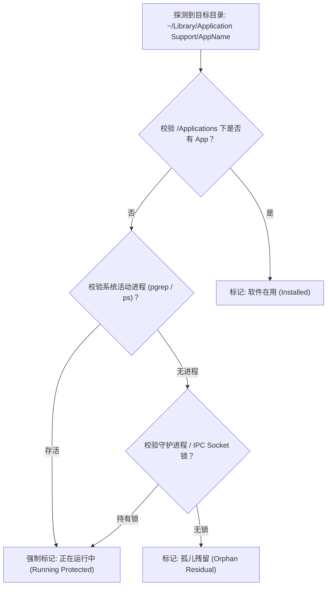

# DevSweep: 现代开发者与 AI Agent 清理工具实战经验与架构设计指南 (v1.1)

> **文档定位**：本文档基于在真实 macOS 环境中对多款知名 AI 编程客户端（Gemini CLI、WorkBuddy、5ire、Kiro、Alma、Trae、Hermes 等）及工业级软件（Adobe、OneDrive、飞书、Steam 等）进行实机排查与清理的完整实操记录，提炼出面向下一代开发者与 AI Agent 专属清理工具的核心架构设计、安全防线与实战经验。

---

## 1. 真实场景复盘与核心数据统计

在本次实操清理中，一台看似“日常维护良好”的 macOS 开发机通过精准定向排查，累计释放了超过 **14 GB** 的真实磁盘空间。这充分证明了针对开发者与 AI 软件的专有清理工具具有极其强烈的现实需求。

### 1.1 本次实机排查与清理成果汇总表

| 软件 / 目标分类 | 发现问题与残留类型 | 占用大小 | 处置方式 | 核心警示与经验 |
| :--- | :--- | :---: | :---: | :--- |
| **Adobe 运行库全套** | 主程序已卸载数年，但 `/Library` 系统级运行时、CameraRaw 预设及 `ARMDCHelper` 增量更新残留 | **~6.22 GB** | 系统级提权删除 | 需区分用户空间与 Root 权限空间 |
| **WorkBuddy AI** | 包含完整工作区历史 SQLite 数据库，且保存了明文 OAuth Token | **~1.70 GB** | 用户空间抹除 | 存在敏感 Token 泄漏风险 |
| **5ire AI 桌面客户端** | 主程序已删，但残留了 BGE-M3 本地向量模型（560M）与离线升级包（181M） | **~741 MB** | 用户空间抹除 | AI 客户端的核心体积多被向量模型吃掉 |
| **Kiro IDE** | VS Code 分支配置、历史扩展与会话缓存 | **~606 MB** | 用户空间抹除 | Electron 架构特有的会话残留 |
| **桌面 DMG/PKG 镜像** | 10 个已安装完但未随手清理的历史安装镜像包 | **~1.06 GB** | 用户空间抹除 | 用户习惯性遗留安装镜像 |
| **飞书 (Lark) & Steam** | 主程序已删，残留海量离线历史网页与运行库缓存 | **~2.10 GB** | 用户空间抹除 | 传统卸载工具漏网的大头孤儿目录 |
| **后台更新包 (Caches)** | 百度网盘、Cursor、阿里云盘、Notion 等后台静默下载的全量安装包 | **~1.50 GB** | 清空更新器目录 | 清空后完全不影响软件在用功能 |
| **违规 Documents 目录** | WWLink (企业微信)、liteav (腾讯音视频)、TTKN (知网)、硬件指纹 | **~22 MB** | 彻底清除 | 软件违规污染 `~/Documents` 用户文档区 |
| **OneDrive 历史同步盘** | 主机遗留历史同步盘，含用户实质业务资料与简历 | **~910 MB** | 移入系统废纸篓 | 严禁暴力硬删，必须先让用户确认 |

---

## 2. 核心防线：零误伤安全架构 (Zero False-Positive Guard)

开发面向开发者的清理工具，**第一优先级永远是安全性**。在本次实战中，我们遭遇了两次极易造成严重后果的“临界点”，据此抽象出三道绝对安全防线。

### 2.1 铁律一：多维存活状态交叉验证（Hermes 案例）



* **实战案例**：
  在检查 `Hermes` 时，常规扫描 `/Applications` 未能直接匹配，但通过底层排查发现 `Hermes` 不仅正在运行，且后台驻留了 Python 网关（PID 91376）、SSH 远程连接和前端桌面应用（PID 7568）。
* **架构改进要求**：
  DevSweep 判定软件是否“已卸载”，**绝对不能只依赖 `/Applications/*.app` 存在与否**。必须交叉核对：
  1. 系统进程表（`Process Table Check`）；
  2. 常驻后台 Supervisor / Daemon；
  3. 目录内的活动文件锁（如 `SingletonLock`、`SingletonSocket`）。只要发现活跃特征，**强制锁定保护，严禁列入默认清理建议**。

---

### 2.2 铁律二：代码仓库与工作区“强制免疫”（Scratch 与 trae_projects 案例）

* **实战案例**：
  * 排查 `~/Documents/Scratch` 时，虽然名字像软件，但其内部包含一个完整的 `.git` 仓库以及用户原创的个人 Markdown 文章。
  * 排查 `~/Documents/trae_projects` 时，内部包含用户的 `offerflow` 源码工程。
* **架构改进要求**：
  1. **递归 `.git` 拦截**：任何待清理的目标路径，在呈现给用户前必须执行快速浅度探测。如果检测到 `.git/`、`.svn/` 或 `.obsidian/` 等标识，**直接阻断一键清理，强制将其归类为【用户工程资产】**。
  2. **白名单路径绝对排除**：禁止将通配符匹配范围无序扩大到 `~/Documents`、`~/Desktop`、`~/Projects` 的一级子目录。

---

### 2.3 铁律三：区分“底层通用框架”与“具体孤儿残留”（MMKV 案例）

* **实战案例**：
  扫描 `MMKV` 时，系统中微信（`xinWeChat`）、剪映（`JianyingPro`）和微信输入法（`WeType`）都在使用它作为核心数据库；而真正的垃圾仅是 `~/Documents/mmkv/` 下脱离了宿主的腾讯诊断遥测日志。
* **架构改进要求**：
  规则引擎必须能够理解**组件化存储（Embedded Key-Value DBs）**。规则库必须精准绑定“宿主 Bundle ID”，严禁使用粗暴的全局关键词正则删除。

---

## 3. 扫描盲区与穿透引擎设计

传统清理软件的最大盲区是默认“认为软件只会把数据写在 `~/Library`”，但现实世界中，大量开发工具和国产软件对文件系统的规范性极差。

### 3.1 “非规范路径猎手”（The Non-Standard Path Hunter）

针对现代开发机，DevSweep 必须设立专用的探测子引擎，重点监控以下“被软件滥用污染”的高发区：

1. **`~/Documents/` 违规写入区**：
   * 腾讯系的日志与硬件互联：`~/Documents/WWLink`、`~/Documents/liteav`、`~/Documents/log`；
   * 知网学术阅读器：`~/Documents/TTKN`；
   * 硬件指纹偷埋：`~/Documents/.qimei`（腾讯 Qimei）、`~/Documents/.UTSystemConfig`（阿里 UserTrack）、`~/Documents/.rqd`（Bugly）；
   * 老版本办公套件：`~/Documents/Microsoft 用户数据`（Office 2011）。
2. **`~/` 用户根目录 Dotfiles 侵占区**：
   * 现代 Agent CLI 工具极其喜欢直接在 `~/.` 下建库：`~/.gemini`、`~/.workbuddy-ai`、`~/.kiro`、`~/.claude`、`~/.codex`、`~/.trae-aicc`。
3. **`~/Library/Application Support/Caches/` 静默更新包黑洞**：
   * Electron 架构软件的通病：自动静默拉取更新包（如 `baidunetdisk-updater`、`cursor-updater`、`notion-updater`），升级后长期滞留，单台机器通常积压 1~3 GB。

---

## 4. AI-Native 专属清理能力设计

这是 DevSweep 与传统通用清理工具拉开代差的核心差异化壁垒。

### 4.1 本地向量模型与权重专属识别器（Model Weights Scanner）

* **痛点**：在 AI 时代，造成磁盘“瞬间告急”的最大元凶不是代码，而是本地向量模型（Embedding Models）和开源 LLM 权重文件。
* **方案**：
  DevSweep 针对 AI 工具设立专有分类标签 `[Local AI Models]`，深度解析以下特征目录：
  * `transformers-models/`（如 HuggingFace、Xenova 缓存）
  * `~/.ollama/models/`
  * `.gguf` / `.onnx` / `.bin` 大文件。
  UI 端单独向用户展示模型名称（如 `bge-m3`、`llama-3-8b`）及其体积，支持一键清空模型而不破坏客户端本身。

### 4.2 敏感凭据与 API Key 隐私审计（Secret Leak Warning）

* **痛点**：许多开发者卸载了工具后，磁盘上依然明文留存着长期有效的 OAuth 刷新凭证（Refresh Token）或 API Key。
* **方案**：
  DevSweep 在扫描到包含敏感鉴权的文件时（如 `oauth_creds.json`、`auth.json`、`workbuddy-desktop-ai.info`），在 UI 上打上**高危隐私警示标（⚠️ Secret Included）**，告知用户清理该项目有助于防御本地凭证被恶意程序读取，赋予工具“安全合规审计”的额外溢价。

---

## 5. 权限分层与删除策略

### 5.1 用户空间与系统空间（Root）分流

```text
DevSweep 清理执行架构:
├── [Tier 1] 用户空间 (User-Space) -> 直接免密执行
│    ├── ~/Library/Caches
│    ├── ~/Library/Application Support
│    └── ~/.config / ~/.<agent>
│
└── [Tier 2] 系统特权空间 (System-Space) -> 需提权
     ├── /Library/Application Support (如 Adobe 3.9G 框架)
     ├── /Applications/Utilities/ (如各类系统卸载器空壳)
     └── 处理机制:
          ├── GUI 模式: 调用 macOS 原生 NSAppleScript 提权授权弹窗
          └── CLI 模式: 生成可审查的 `sudo rm -rf` 组合命令供用户确认粘贴
```

### 5.2 默认“废纸篓软着陆”（Safe Recycle by Default）

* 凡是涉及 `~/Documents`、`~/Desktop` 等用户直接感知区域的文件（如旧的同步盘目录、历史草稿），**默认禁止物理擦除（`rm -rf`）**；
* 必须统一调用 macOS 原生废纸篓 API（`NSWorkspace.shared.recycle`），确保误操作时可在 30 天内一键还原。

---

## 6. 演进后的规则库数据规范 (Schema v1.1)

在 v1.0 基础上，融合上述实战经验，正式引入 `process_names`（进程保护）、`contains_secrets`（敏感词提示）与 `model_weights`（模型标记）：

```yaml
# ==========================================================
# DevSweep Rule Schema v1.1 (Updated)
# ==========================================================
id: 5ire
name: 5ire AI Desktop
category: desktop-agent
vendor: 5ire

# 1. 活跃保护机制 (只要进程存在即阻断清理)
protection:
  process_names:
    - 5ire
    - 5ire Helper
  lock_files:
    - ~/Library/Application Support/5ire/SingletonLock

# 2. 安装与检测特征
detection:
  app_bundle_id:
    - com.5ire.app
  app_paths:
    - /Applications/5ire.app

# 3. 分类目标路径
targets:
  # 敏感凭据 (Token/Key)
  credentials:
    - path: ~/Library/Application Support/5ire/config.json
      description: "包含配置的 Gemini/OpenAI API Key"
      contains_secrets: true

  # 本地 AI 模型权重
  ai_models:
    - path: ~/Library/Application Support/5ire/transformers-models
      description: "Xenova BGE-M3 本地向量嵌入模型"
      is_model_weight: true

  # 纯更新包与缓存
  caches:
    - path: ~/Library/Application Support/Caches/5ire-updater
      description: "静默下载的离线安装包"
      default_selected: true

  # 历史数据库与支持文件
  data_and_history:
    - path: ~/Library/Application Support/5ire
      description: "历史对话数据库 (5ire.db)"
      default_selected: true

# 4. 安全防护策略
safety:
  protect_git_repos: true
  exclude_paths:
    - ~/Documents
    - ~/Projects
```

---

## 7. 下一步演进路线规划 (Roadmap)

1. **Phase 1: 规则库开源与标准化（当前阶段）**
   * 将本次实操积累的规则沉淀为独立的 YAML 库，托管于 GitHub。
2. **Phase 2: 核心扫描引擎 CLI 原型 (Go / Rust)**
   * 实现一个支持 `--dry-run` 预览、具备“进程守护检测”和“Git 免疫防线”的极速单二进制 CLI 工具。
3. **Phase 3: 上架 Raycast 插件生态**
   * 借助 Raycast 的高开发者浓度，以极低开发成本迅速触达全球 macOS 程序员。
4. **Phase 4: 独立轻量原生桌面客户端 (SwiftUI / Tauri)**
   * 提供可视化的大模型残留热力图展示，支持一键健康体检。
