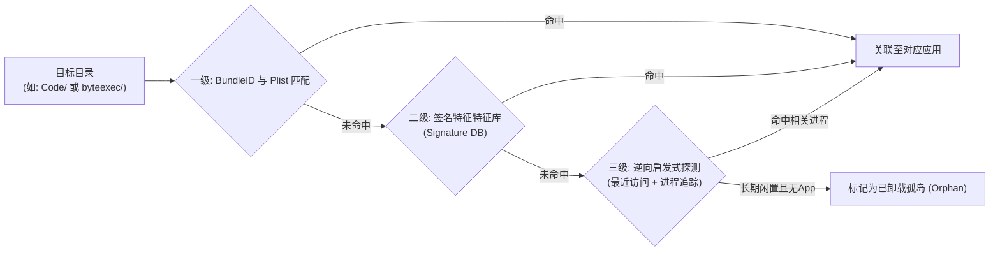
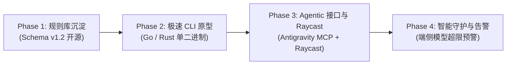

# DevSweep: 现代开发者与 AI Agent 清理工具实战经验与架构设计指南 (v1.2)

> **版本**：v1.2 (Milestone Release)  
> **文档定位**：本文档基于在真实 macOS 开发者环境中的多轮实机深度排查与清理实操（累计安全释放磁盘空间超过 **20 GB**），结合数十款工业级软件、AI 编程工具、浏览器多通道版本以及本地端侧大模型的落地特征，系统化沉淀出的面向下一代开发者与 AI Agent 的专属磁盘存储治理与深度清理系统架构指南。

---

## 1. 真实场景复盘与核心数据统计

在一台看似“日常维护良好”且长期活跃的 macOS 现代开发机中，通过多轮精准定向排查与多维度扫描，累计释放了超过 **20 GB** 的深层冗余空间。

实战证明：**现代开发者的磁盘吞噬元凶，已经从早期的“系统日志与语言包”，彻底转移至“AI 端侧大模型、本地向量数据库、测试通道孤岛与跨平台落盘 Bug”。**

### 1.1 实机排查与清理成果汇总表（v1.1 + v1.2 联合战果）

| 软件 / 目标分类 | 发现问题与残留类型 | 占用大小 | 处置方式 | 核心警示与架构经验 (Lessons Learned) |
| :--- | :--- | :---: | :---: | :--- |
| **Adobe 运行库全套** | 主程序已卸载数年，但 `/Library` 系统级运行时、CameraRaw 预设及 `ARMDCHelper` 残留 | **~6.22 GB** | 系统级提权删除 | 严格区分用户空间（User-Space）与 Root 权限空间 |
| **Google Chrome 端侧模型** | `OptGuideOnDeviceModel` 目录静默拉取端侧大语言模型（Gemini Nano） | **4.00 GB** | 针对性模型裁剪 | 传统清理工具对应用内静默落盘的端侧大模型完全失明 |
| **Cherry Studio AI** | 本地多模型会话库（1.5G `Data/`）与本地向量嵌入库（1.2G `IndexedDB/`） | **2.90 GB** | 精细化子项清理 | Electron 类 AI 客户端呈现“二进制附件+向量嵌入”双重膨胀 |
| **WorkBuddy AI** | 包含完整工作区历史 SQLite 数据库，且保存了明文 OAuth Token | **~1.70 GB** | 用户空间抹除 | 废弃应用残留存在严重的敏感 Token / Key 泄漏风险 |
| **后台更新包 (Caches)** | 百度网盘、Cursor、阿里云盘、Notion 等后台静默下载的全量安装包 | **~1.50 GB** | 清空更新器目录 | 清空后完全不影响软件在用功能，升级后更新包常年死锁 |
| **飞书 (Lark) & Steam** | 主程序已删，残留海量离线历史网页与运行库缓存 | **~2.10 GB** | 用户空间抹除 | 传统卸载工具漏网的大头孤儿目录 |
| **桌面 DMG/PKG 镜像** | 10 个已安装完但未随手清理的历史安装镜像包 | **~1.06 GB** | 用户空间抹除 | 建立临时下载与镜像包的主动生命周期感知 |
| **已卸载应用历史残留 (79款)** | 包含 Skype、Jan、Quark、Notion Mail、CindyGlobal、Citro Labs、Accio、Comet 等 | **~3.10 GB** | 时间戳废纸篓隔离 | 建立应用名与目录名脱节的三级反向映射引擎 |
| **5ire AI 桌面客户端** | 主程序已删，残留 BGE-M3 本地向量模型（560M）与离线升级包（181M） | **~741 MB** | 用户空间抹除 | AI 客户端的核心体积多被本地模型权重吃掉 |
| **Kiro IDE** | VS Code 分支配置、历史扩展与会话缓存 | **~606 MB** | 用户空间抹除 | Electron 架构特有的工作区与插件会话堆积 |
| **微信 web 开发者工具** | 模拟器运行环境与长期堆积的项目构建缓存 | **~514 MB** | 移入废纸篓 | 开发者工具二次打开会自动按需重新生成，可安全释放 |
| **测试通道孤岛 (Edge)** | Canary (212M) 与 Dev (52M) 测试通道，用户已稳定在正式版但旧分支长期滞留 | **~264 MB** | 通道对比后清除 | 引入发布通道交叉核对算法（Channel Cross-Check） |
| **OneDrive 历史同步盘** | 主机遗留历史同步盘，含用户实质业务资料与简历 | **~910 MB** | 移入系统废纸篓 | 严禁暴力硬删，必须先让用户确认，并提供软着陆隔离 |
| **违规 Documents 目录** | WWLink (企业微信)、liteav (腾讯音视频)、TTKN (知网)、硬件指纹 | **~22 MB** | 彻底清除 | 重点监控并拦截第三方软件对 `~/Documents` 文档区的滥用 |
| **根目录散落与幽灵目录** | 10 年前解包图片（`2052-TM1000*.png`）、空锁文件、代码 Bug 目录 `(null)` | **~2 MB** | 根目录散落扫描 | 传统工具只遍历二级目录，漏扫 Application Support 根节点 |

---

## 2. 核心防线：零误伤安全架构 (Zero False-Positive Guard)

面向开发者的存储治理，**安全性高于一切**。实操中提炼出四大绝对安全防线：

### 2.1 铁律一：多维存活状态交叉验证（Hermes 案例）


* **实战案例**：
  在检查 `Hermes` 时，常规扫描 `/Applications` 未能直接匹配，但通过底层排查发现 `Hermes` 不仅正在运行，且后台驻留了 Python 网关（PID 91376）、SSH 远程连接和前端桌面应用（PID 7568）。
* **架构改进要求**：
  DevSweep 判定软件是否“已卸载”，**绝对不能只依赖 `/Applications/*.app` 存在与否**。必须交叉核对：
  1. 系统进程表（`Process Table Check`）；
  2. 常驻后台 Supervisor / LaunchDaemon / LaunchAgent；
  3. 目录内的活动文件锁（如 `SingletonLock`、`SingletonSocket`）。只要发现活跃特征，**强制锁定保护，严禁列入默认清理建议**。

---

### 2.2 铁律二：代码仓库与工作区“强制免疫”（Scratch 与 trae_projects 案例）

* **实战案例**：
  * 排查 `~/Documents/Scratch` 时，虽然名字像软件，但其内部包含一个完整的 `.git` 仓库以及用户原创的个人 Markdown 文章。
  * 排查 `~/Documents/trae_projects` 时，内部包含用户的 `offerflow` 源码工程。
* **架构改进要求**：
  1. **递归 `.git` 拦截**：任何待清理的目标路径，在呈现给用户前必须执行快速浅度探测。如果检测到 `.git/`、`.svn/`、`.hg/` 或 `.obsidian/` 等标识，**直接阻断一键清理，强制将其归类为【用户工程资产】**。
  2. **白名单路径绝对排除**：禁止将通配符匹配范围无序扩大到 `~/Documents`、`~/Desktop`、`~/Projects` 的一级子目录。

---

### 2.3 铁律三：区分“底层通用框架”与“具体孤儿残留”（MMKV 案例）

* **实战案例**：
  扫描 `MMKV` 时，系统中微信（`xinWeChat`）、剪映（`JianyingPro`）和微信输入法（`WeType`）都在使用它作为核心嵌入式数据库；而真正的垃圾仅是 `~/Documents/mmkv/` 下脱离了宿主的腾讯诊断遥测日志。
* **架构改进要求**：
  规则引擎必须能够理解**组件化存储（Embedded Key-Value DBs）**。规则库必须精准绑定“宿主 Bundle ID”，严禁使用粗暴的全局关键词正则删除。

---

### 2.4 铁律四：系统红线硬白名单保护（System Redline Vault）

* **实战案例**：
  在深度扫描 `~/Library/Application Support/` 时，大量系统服务和关键安全数据库混杂其中（如 `com.apple.TCC`、`AddressBook`、`CallHistoryDB`、`CloudDocs`、`com.apple.sharedfilelist`）。
* **架构改进要求**：
  * `com.apple.TCC` 保存了 macOS 所有麦克风、摄像头、辅助功能及完全磁盘访问权限；一旦被清空，整个系统的权限状态将瞬间损坏。
  * **DevSweep 设立不可逾越的“系统红线库”**：对 `com.apple.*` 及系统关键原生服务执行严格白名单隔离，UI 界面直接上锁并硬编码阻断任何删除操作。

---

## 3. 现代扫描盲区与穿透引擎设计

传统清理软件的最大缺陷在于假设“软件会严格遵守 Apple Sandbox 规范只把数据写在二级子目录”。现实中，跨平台框架与开发工具的落盘行为极不规范。

### 3.1 跨平台落盘 Bug 与根目录散落探测 (RootOrphanScanner)

* **异常命名判定规则**：
  * 正则匹配明显由代码 Bug、空指针返回生成的异常目录：`^(\(null\)|undefined|null|none|\s+)$`。实战中成功命中并清除了 `(null)` 幽灵目录。
* **根目录散落单文件识别**：
  * 针对直属 `~/Library/Application Support/` 根节点的散落文件建立扫描机制，精准捕获 10 年前跨平台安装包解压残留的中文引导图（`2052-TM1000*.png`）、CoreData 根目录违规数据库（`default.store`）及过期隐藏锁文件（`.ACCC_Lock`、`.ADCS_Lock`）。
* **空骨架目录识别（Skeleton Dir Detection）**：
  * 如 **`ProApps`**（空 LUT / 导出预设目录），大小 $< 64\text{ KB}$ 且递归子项全部为空。提供“空壳结构安全清理”选项，保持目录清爽。

### 3.2 多通道发布孤岛检测 (ChannelRedundancyScanner)

针对开发者群体常并存安装前沿测试版（Canary / Dev / Beta）与正式版（Stable）的习惯：
1. **通道家族识别**：自动关联同一产品的分支矩阵：
   * `Microsoft Edge` / `Edge Canary` / `Edge Dev`
   * `Google Chrome` / `Chrome Beta` / `Chrome Canary`
   * `VS Code` / `VS Code Insiders`
2. **活跃度仲裁**：当检测到正式版处于高频使用状态，而 Canary / Dev 已超过 90 天未被启动时，主动提示用户“一键清理停用的测试通道”。

### 3.3 应用名与存储路径脱节的三级反向映射引擎 (Association Engine)

解决“应用名叫 VS Code，数据目录却叫 Code；应用名叫 ChatGPT，目录叫 com.openai.chat”导致的漏报难题：



---

## 4. AI-Native 专属治理能力设计

这是 DevSweep 与传统通用清理工具拉开技术代差的核心壁垒。

### 4.1 端侧 AI 模型与权重专项识别 (AIModelScanner)

* **痛点**：现代应用（如 Chrome、Ollama、Jan、Cherry Studio）会静默拉取百兆至数吉字节的本地模型，传统工具对其完全透明。
* **方案**：
  设立专有扫描器，深度识别：
  * 浏览器端侧模型：`Google/Chrome/*/OptGuideOnDeviceModel`
  * 运行时模型池：`~/.ollama/models/`、`transformers-models/`
  * 大模型通用后缀：`.gguf` / `.safetensors` / `.onnx` / `.bin`
  UI 上独立标注模型名称（如 `Gemini Nano`、`bge-m3`）及体积，支持独立释放模型而不损毁宿主软件。

### 4.2 本地会话库与向量嵌入细分裁剪

* 针对 `CherryStudio` 等多模型客户端：
  * **文档与会话附件区**：`Data/`（1.5 GB）
  * **向量嵌入与消息流**：`IndexedDB/`（1.2 GB）
  * 提供细粒度的“保留配置与对话，仅清除大文件附件与过期嵌入缓存”裁剪模式。

### 4.3 敏感凭据与 API Key 隐私审计 (Secret Leak Warning)

* 扫描到包含明文鉴权或持久化 Token 的文件（如 `oauth_creds.json`、`auth.json`、`bootstrap_token.enc`）时，打上高危隐私警示标（⚠️ Secret Included），强调清理对防御本地凭据窃取的安全价值。

---

## 5. 原子隔离与一键无损回滚系统设计 (Quarantine & Rollback)

传统工具执行 `rm -rf` 极易引发不可挽回的误删。DevSweep 提出**时间戳隔离归档机制**：

```
~/.Trash/AppSupport_Cleanup_20261113_174608/
├── manifest.json                  # 元数据清单（记录原绝对路径、时间戳、所属 App）
├── (null)/                        # 完整隔离的原始目录
├── Skype/                         # 保持完整文件树
└── 2052-TM10002069.png
```

### 5.1 回滚清单规范 (`manifest.json`)
```json
{
  "version": "1.2.0",
  "session_id": "cleanup_20261113_174608",
  "created_at": "2026-11-13T17:46:08+08:00",
  "total_reclaimed_bytes": 3328599654,
  "items": [
    {
      "name": "Skype",
      "original_path": "/Users/milong/Library/Application Support/Skype",
      "target_relative_path": "Skype",
      "size_bytes": 289406976,
      "risk_level": "L2_ORPHAN",
      "reason": "Application 'Skype.app' is not installed in /Applications"
    }
  ]
}
```

### 5.2 回滚实现逻辑
用户只需执行 `devsweep rollback [session_id]`，引擎将逐条解析 `manifest.json`，并将文件夹安全 `mv` 恢复至原路径，真正实现零心理负担的深度清理。

---

## 6. 四级安全防护矩阵

| 级别 | 定义 | 典型对象 | 处理方式 |
| :--- | :--- | :--- | :--- |
| **L1: 极低风险 (Zero-Impact Junk)** | 纯垃圾文件、空锁、Bug 目录 | 历史散落图片、`.ACCC_Lock`、`(null)`、旧图标库 | **默认勾选**，一键归档移入废纸篓 |
| **L2: 明确已卸载 (Orphaned Apps)** | 对应软件已删除，残留完整配置 | `Notion Mail`、`Skype`、`Citro Labs`、`Jan` | **默认勾选**，移入废纸篓隔离区 |
| **L3: 在用软件减负 (Bloatware/Cache)** | 正在使用的软件，但内部堆积了模型/临时缓存 | Chrome 端侧模型 (4GB)、CherryStudio 向量库 (1.2GB) | **默认不勾选**，高亮提示空间，由用户明确勾选 |
| **L4: 绝对安全红线 (Protected System)** | macOS 系统核心数据、安全权限数据库 | `com.apple.TCC`、`AddressBook`、`CloudDocs`、`Keychain` | **硬编码屏蔽**，UI 界面完全不提供删除操作 |

---

## 7. 规则库数据规范 (Rule Schema v1.2)

在 v1.1 基础上，正式扩充 `channel_type`（发布通道）、`storage_architecture`（模型/向量存储架构）与 `root_orphan_patterns`（根目录孤岛规则）：

```yaml
# ==========================================================
# DevSweep Rule Schema v1.2 (Milestone Update)
# ==========================================================
id: chrome-ecosystem
name: Google Chrome Ecosystem
category: browser
vendor: Google

# 1. 活跃保护机制
protection:
  process_names:
    - "Google Chrome"
    - "Google Chrome Helper"
  lock_files:
    - ~/Library/Application Support/Google/Chrome/SingletonLock

# 2. 多通道分支对比
channels:
  current_channel: stable
  related_channels:
    - id: chrome-canary
      name: "Google Chrome Canary"
      data_path: ~/Library/Application Support/Google/Chrome Canary
    - id: chrome-beta
      name: "Google Chrome Beta"
      data_path: ~/Library/Application Support/Google/Chrome Beta

# 3. 目标细分与端侧模型标识
targets:
  ai_models:
    - path: ~/Library/Application Support/Google/Chrome/*/OptGuideOnDeviceModel
      description: "Chrome Optimization Guide 端侧 AI 大语言模型"
      is_model_weight: true
      regenerable: true
      risk_level: L3_USER_CONFIRM

  caches:
    - path: ~/Library/Application Support/Google/Chrome/*/component_crx_cache
      description: "已安装扩展组件 CRX 安装包缓存"
      default_selected: true
      risk_level: L1_SAFE

# 4. 根目录与幽灵项匹配
ghost_rules:
  root_patterns:
    - regex: '^2052-TM\d+\.png$'
      description: "历史解包残留的简体中文引导图片"
    - regex: '^\.ACCC_Lock$'
      description: "Adobe 历史零字节死锁标记"
    - regex: '^\(null\)$'
      description: "代码空指针 Bug 产生的幽灵目录"
```

---

## 8. 下一步演进路线规划 (Roadmap)



1. **Phase 1: 规则库标准化与开源**：将本次实操积累的规则沉淀为独立的 YAML 库，托管于开源社区。
2. **Phase 2: 核心扫描引擎 CLI 原型 (Go / Rust)**：实现支持 `--dry-run` 预览、具备“进程守护检测”、“Git 免疫防线”与“时间戳隔离区”的极速单二进制工具。
3. **Phase 3: Agentic 原生能力与插件生态**：
   * 打包为 **Antigravity / Claude Code 的标准 MCP Server / Skill**，让开发者通过自然语言直接进行交互式存储治理；
   * 上架 Raycast 插件生态，覆盖高频开发者工作流。
4. **Phase 4: 自动化守护机制 (Health Daemon)**：后台轻量监听，当检测到某个应用静默拉取了超过 2GB 的端侧大模型或再次出现 `(null)` 幽灵目录时，主动推送优雅减负建议。
