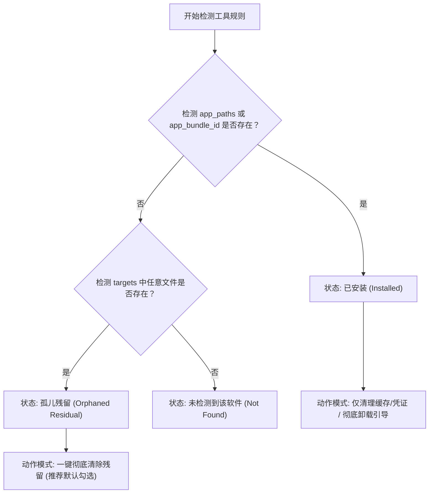

# DevSweep 规则库架构设计规范 (Schema v1.0)

本文档定义了面向 AI 编程工具与开发者软件的清理规则规范（Rule Schema）。该规范支持精确识别软件状态（已安装/已卸载残留）、按数据敏感度与清理类型分类、以及严密的安全防护与白名单策略。

---

## 1. 架构设计哲学

传统清理软件（如 CleanMyMac、AppCleaner）通常采用“以 App Bundle 为中心”的设计，仅匹配 `~/Library` 下的 Bundle ID 文件夹。这在面对现代 AI 编程工具与 Agent CLI 时完全失效。

DevSweep 规则库遵循 **三层核心原则**：
1. **双态感知（Dual-State Awareness）**：区分软件是“未卸载仅清理缓存/凭证”还是“软件已移除但留有残留（孤儿残留）”。
2. **分类分级清理（Granular Target Classification）**：明确区分 **Cache（纯缓存）**、**Config（配置）**、**Credentials（敏感凭据）**、**Data（会话历史与数据库）**、**Binary（CLI 脚本）**，避免一刀切。
3. **零误伤防线（Zero False-Positive Protection）**：针对 AI 智能体常常在用户主目录建立 projects/workspaces 的特性，强制内置代码仓库白名单与保护拦截。

---

## 2. 规则数据结构定义 (Rule Schema Specification)

规则库支持使用 **YAML** 或 **JSON** 格式进行定义。单条工具规则的核心字段结构如下：

```yaml
# ==========================================================
# DevSweep Rule Schema v1.0
# ==========================================================

# 1. 元信息
id: string                  # 唯一标识符，全小写中划线命名，如 "workbuddy", "alma"
name: string                # 人类可读名称，如 "WorkBuddy AI"
category: enum              # 分类: "ide" | "cli-agent" | "desktop-agent" | "runtime" | "extension"
vendor: string              # 厂商/开发者，如 "Yetone", "Tencent", "Google"
homepage: string            # 项目主页或仓库 URL

# 2. 软件安装状态检测 (Status Detection)
detection:
  app_bundle_id:            # macOS 应用程序 Bundle ID（可选，主要针对 GUI 桌面端）
    - string
  app_paths:                # 常见的可执行应用路径（可选）
    - string
  cli_binaries:             # 终端中暴露的可执行文件或软链接（可选）
    - string

# 3. 目标清理路径分类 (Targets)
# 支持波浪号 `~` 自动展开，支持通配符 `*`
targets:
  # 3.1 纯缓存 (可安全随时清理，无数据损失风险)
  caches:
    - path: string
      description: string
      default_selected: true

  # 3.2 偏好设置与状态
  preferences:
    - path: string
      description: string
      default_selected: true

  # 3.3 敏感鉴权凭据 (涉及隐私，清理后需重新登录)
  credentials:
    - path: string
      description: string
      default_selected: true
      contains_secrets: true  # 标记为敏感信息（Token/OAuth）

  # 3.4 历史记录与数据库 (可能包含对话记忆、本地向量库)
  data_and_history:
    - path: string
      description: string
      default_selected: true

  # 3.5 配置文件与扩展插件
  configs:
    - path: string
      description: string
      default_selected: false # 建议默认取消勾选，除非用户确认全面抹除

  # 3.6 终端暴露的全局命令与脚本
  binaries_and_scripts:
    - path: string
      description: string
      default_selected: true

# 4. 安全防护与白名单 (Safety Guard)
safety:
  protect_git_repos: true   # 如果目标路径内探测到 .git 目录，直接阻断删除并警告
  exclude_paths:            # 严格排除路径
    - "~/Documents"
    - "~/Desktop"
    - "~/Projects"
```

---

## 3. 状态判定状态机 (Detection Logic)



---

## 4. 实测验证指纹库（首批规则定义）

基于我们在本机环境验证过的几个核心工具，实测整理出以下第一批高质量指纹规则：

````carousel
```yaml
# rules/alma.yaml
id: alma
name: Alma
category: desktop-agent
vendor: Yetone
homepage: https://github.com/yetone
detection:
  app_bundle_id:
    - com.yetone.alma
  app_paths:
    - /Applications/Alma.app
  cli_binaries:
    - ~/.local/bin/alma

targets:
  binaries_and_scripts:
    - path: ~/.local/bin/alma
      description: "CLI 脚本入口"
  configs:
    - path: ~/.config/alma
      description: "Agent 技能库与配置"
  caches:
    - path: ~/.cache/alma
      description: "运行时临时缓存"
  data_and_history:
    - path: ~/Library/Application Support/alma
      description: "历史会话数据库 (chat_threads.db) 与工作区"
  preferences:
    - path: ~/Library/Preferences/com.yetone.alma.plist
      description: "系统偏好设置"
    - path: ~/Library/Preferences/ByHost/com.yetone.alma.ShipIt.*.plist
      description: "自动更新组件偏好"
```
<!-- slide -->
```yaml
# rules/workbuddy.yaml
id: workbuddy
name: WorkBuddy AI
category: desktop-agent
vendor: Tencent / WorkBuddy
homepage: https://www.workbuddy.ai
detection:
  app_bundle_id:
    - com.workbuddy.workbuddy
    - dev.genie.workbuddy
  app_paths:
    - /Applications/WorkBuddy.app

targets:
  credentials:
    - path: ~/Library/Application Support/CodeBuddyExtension/Data/Public/auth/workbuddy-desktop-ai.info
      description: "核心 OAuth 访问令牌与账号信息"
      contains_secrets: true
  configs:
    - path: ~/.workbuddy
      description: "主配置与技能目录"
    - path: ~/.workbuddy-key-fallback
      description: "备用鉴权目录"
  data_and_history:
    - path: ~/.workbuddy-ai
      description: "历史工作区数据库、日志与 SQLite 存储"
    - path: ~/Library/Application Support/WorkBuddy
      description: "应用持久化存储"
    - path: ~/Library/Application Support/WorkBuddyExtension
      description: "配套扩展组件"
    - path: ~/Library/Application Support/@genie/workbuddy-desktop
      description: "桌面运行时数据"
  preferences:
    - path: ~/Library/Preferences/ByHost/com.workbuddy.workbuddy.ShipIt.*.plist
      description: "更新偏好设置"
```
<!-- slide -->
```yaml
# rules/kiro.yaml
id: kiro
name: Kiro
category: ide
vendor: Kiro.dev
homepage: https://kiro.dev
detection:
  app_bundle_id:
    - dev.kiro.desktop
  app_paths:
    - /Applications/Kiro.app

targets:
  configs:
    - path: ~/.kiro
      description: "VS Code 分支配置、扩展与 skills"
  data_and_history:
    - path: ~/Library/Application Support/Kiro
      description: "核心会话、Cookies、扩展安装目录"
  caches:
    - path: ~/Library/HTTPStorages/dev.kiro.desktop
      description: "网络传输缓存"
  preferences:
    - path: ~/Library/Preferences/dev.kiro.desktop.plist
      description: "窗口与偏好设置"
    - path: ~/Library/Preferences/ByHost/dev.kiro.desktop.ShipIt.*.plist
      description: "更新配置"
```
<!-- slide -->
```yaml
# rules/gemini-antigravity.yaml
id: gemini-antigravity
name: Google Antigravity & Gemini CLI
category: ide
vendor: Google DeepMind
homepage: https://github.com/google-gemini
detection:
  app_bundle_id:
    - com.google.antigravity
  cli_binaries:
    - ~/.gemini/bin/agy

targets:
  binaries_and_scripts:
    - path: ~/.gemini/bin
      description: "Antigravity CLI (agy) 可执行程序"
  credentials:
    - path: ~/.gemini/google_accounts.json
      description: "激活的 Google 账号"
      contains_secrets: true
    - path: ~/.gemini/oauth_creds.json
      description: "OAuth Refresh Token 及鉴权凭据"
      contains_secrets: true
    - path: ~/.gemini/jetski-standalone-oauth-token
      description: "独立 Token 凭据"
      contains_secrets: true
  configs:
    - path: ~/.gemini/settings.json
      description: "全局环境与 MCP 服务设置"
    - path: ~/.gemini/config
      description: "插件与扩展配置"
  data_and_history:
    - path: ~/.gemini/antigravity
      description: "运行时数据与任务历史"
    - path: ~/Library/Application Support/com.google.GeminiMacOS
      description: "桌面端系统支持数据"
```
<!-- slide -->
```yaml
# rules/claude-code.yaml
id: claude-code
name: Claude Code
category: cli-agent
vendor: Anthropic
homepage: https://anthropic.com
detection:
  cli_binaries:
    - ~/.local/bin/claude
    - /usr/local/bin/claude

targets:
  credentials:
    - path: ~/.claude/settings.json
      description: "Anthropic 鉴权与配置"
      contains_secrets: true
  data_and_history:
    - path: ~/.claude
      description: "会话历史、项目上下文与成本统计"
```
<!-- slide -->
```yaml
# rules/codex.yaml
id: codex
name: OpenAI Codex CLI
category: cli-agent
vendor: OpenAI
homepage: https://openai.com
detection:
  cli_binaries:
    - ~/.local/bin/codex
    - /usr/local/bin/codex

targets:
  credentials:
    - path: ~/.codex/auth.json
      description: "OpenAI 授权与 Access Token"
      contains_secrets: true
  data_and_history:
    - path: ~/.codex/logs_2.sqlite
      description: "运行任务历史数据库"
    - path: ~/.codex/thread_history_1.sqlite
      description: "历史对话 SQLite"
    - path: ~/.codex
      description: "全局状态与项目上下文快照"
```
````

---

## 5. 扩展与维护机制

1. **去中心化规则更新**：
   规则文件存放于独立仓库（如 `devsweep-rules`），客户端启动或执行 `devsweep update` 时从 GitHub 拉取最新规则 YAML，无需频繁发布客户端版本。
2. **社区贡献模式**：
   任何开发者发现某个新兴 AI 工具清理不干净时，只需提交一个单文件的 YAML Pull Request，审核合入即可惠及所有用户。
